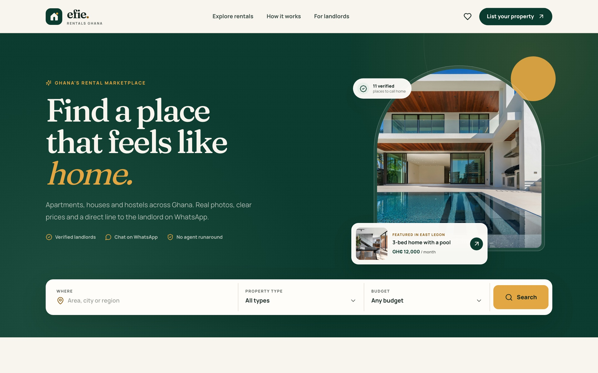

# Efie

**Find a place that feels like home.**

Efie is a rental marketplace for Ghana. Landlords post houses, apartments, hostels, single rooms and short stays. Renters browse real listings, see the rent and location up front, and contact the landlord directly on WhatsApp or by phone — no agents in the middle.



<p align="center">
  
</p>

## What it does

**For renters**

- Browse every rental in one place, with search, area, type, price, bedroom, furnishing and verified filters.
- See rent, deposit, availability, amenities, photos and an area guide on each listing.
- Contact the landlord directly through WhatsApp or a phone call.
- Save rentals and pick up where you left off — saved homes persist in the browser.
- Use the full experience on mobile, with a fixed contact bar on listing pages.

**For landlords**

- Post a property with photos, pricing, amenities and a map location in a few minutes.
- Preview the listing before publishing.
- Manage published listings from a dashboard and remove them when they are gone.
- Photos are compressed in the browser, then uploaded to Supabase Storage when a
  backend is configured.

## Tech stack

- [Vite](https://vite.dev/) 8 + [React](https://react.dev/) 19 + TypeScript
- [React Router](https://reactrouter.com/) with `HashRouter` for static hosting
- [Lucide](https://lucide.dev/) icons
- Fraunces + Manrope via Fontsource
- Hand-written CSS design system — no UI framework
- [Supabase](https://supabase.com/) (optional) for shared listings, saved homes
  and photo storage
- Browser `localStorage` as the fallback when Supabase is not configured

## Run locally

```bash
npm install
npm run dev
```

The app runs at `http://localhost:5173`.

```bash
npm run typecheck   # TypeScript check
npm run build       # production build in dist/
npm run preview     # preview the production build
```

## Deployment

The production build uses a relative Vite `base` and hash-based routing, so `dist/` can be hosted at any path. The live site is published from the `gh-pages` branch to GitHub Pages:

<https://pkaycodes.github.io/efie/>

## Shared database

The site works without a backend, but posts and saved homes then live only in the
browser that created them. To make listings shared between visitors, connect a
free Supabase project:

1. Run the SQL in [`supabase/schema.sql`](supabase/schema.sql).
2. Enable anonymous sign-ins in Supabase Authentication settings.
3. Add `VITE_SUPABASE_URL` and `VITE_SUPABASE_ANON_KEY` to `.env.local`.

Full steps are in [`SUPABASE_SETUP.md`](SUPABASE_SETUP.md).

## Demo notice

This is a portfolio/demo project. The seeded listings, photos, prices and phone numbers are sample data, not real property offers. Without Supabase configured, landlord posts and saved rentals live only in the browser that created them. Always verify a property, its ownership and the tenancy agreement in person before paying anything.

## Project structure

```
src/
  components/   header, footer, listing cards, dialogs, search
  data/         seeded listings, areas and Ghana locations
  lib/          store, formatting, image compression, page titles
  pages/        home, browse, detail, post, saved, dashboard, info, 404
  index.css     design system and responsive styles
public/
  images/       property photography
  favicon.svg
```
